# Industriova

**A business analysis and product-design portfolio demonstrated through a working industrial simulation.**

Industriova, formerly Production Zero, is a Python desktop application in which a player builds production chains, manages shared storage and energy, and transports goods to markets and contracts. For recruiters and Business Analysts, it offers an inspectable example of turning complex requirements into working software: modeling dependencies, defining consistent rules, directing AI-assisted implementation and checking the results through tests and playtest feedback.

## My Role

I conceived the product and designed its gameplay loop, domain architecture and features. I planned and prioritised the development work, translated ideas into requirements, and directed AI agents through implementation. I reviewed the results against the intended rules and used test findings and playtest observations to guide revisions. AI agents wrote the implementation code; I did not personally program it. The [case study](docs/CASE_STUDY.md#human-direction-and-ai-assisted-work) explains this division of responsibility and the supporting evidence.

This is a development playtest, not a finished commercial release. Distribution metadata is `0.3.0.dev1`; the default application ruleset identifies itself as `0.3.0.contract-auto-test`. An optional performance mode has its own version and save directory. See the [validation report](docs/PORTFOLIO_RELEASE_REPORT.md) for the reviewed state and limitations.

**For reviewers:** start with the [case study](docs/CASE_STUDY.md), then inspect the linked code and tests. No player population, business revenue or production banking deployment is claimed.

## Screenshots

The three images below are actual application renders from synthetic QA data at 1600 × 980, captured without loading a personal save. They illustrate configured production, logistics and research, not a naturally played progression or native usability acceptance.

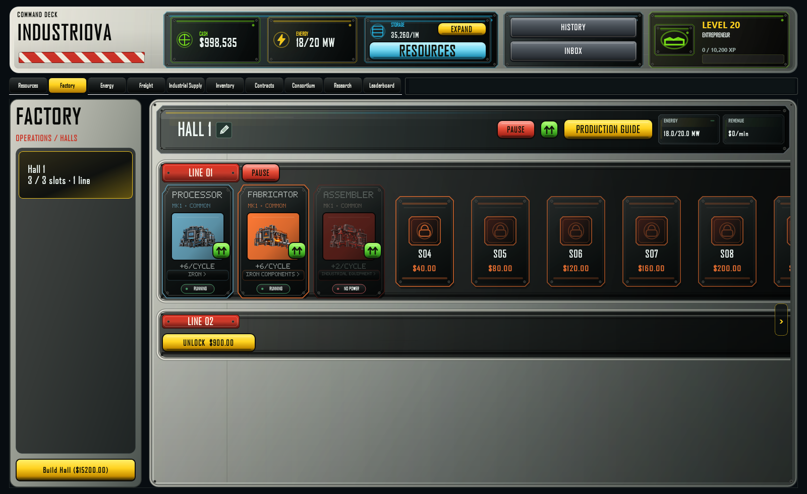
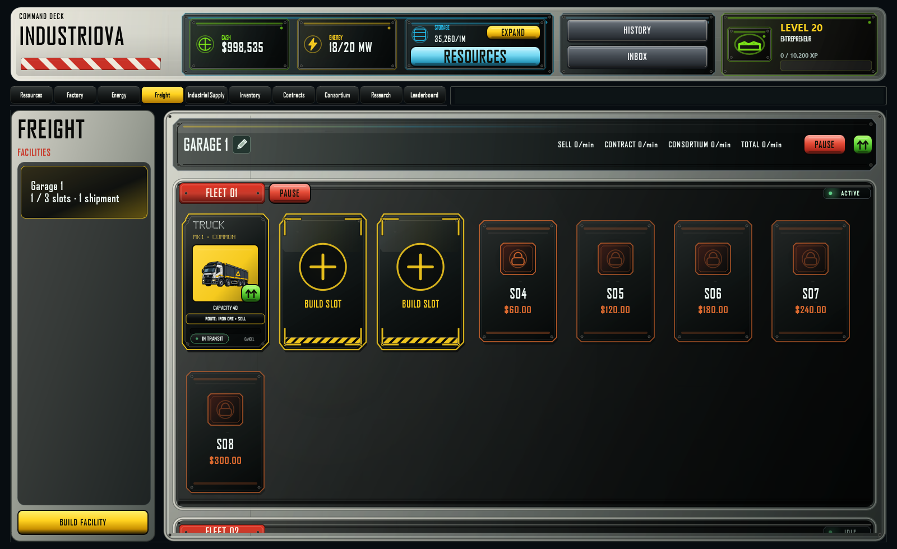
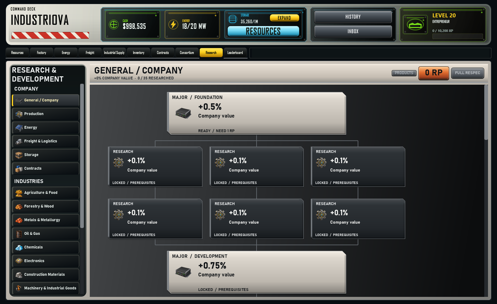

Capture provenance: [manifest](docs/images/captures.json). Reproduce with `python scripts/capture_portfolio.py` after installation.

<details>
<summary>More application views — eight owner-supplied screenshots</summary>

These additional screenshots show an owner-provided session with development controls visible. They are kept separately from the synthetic QA captures and do not establish formal native acceptance. The original files were copied without changing their pixels; see the [screenshot manifest](docs/images/playtest/captures.json).

**Primary resource production**

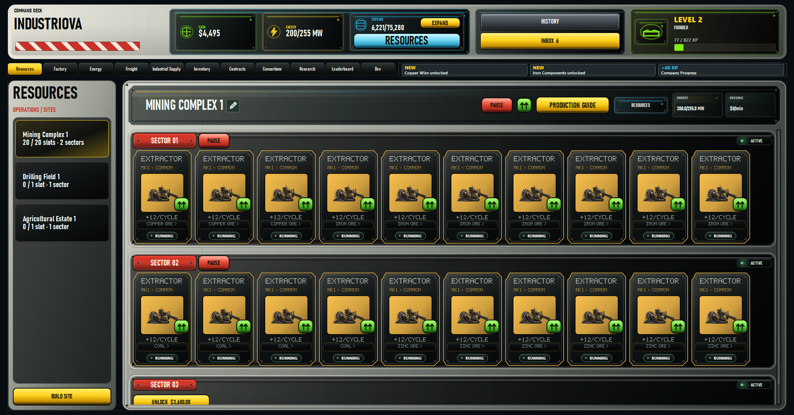

**Factory production and configuration states**

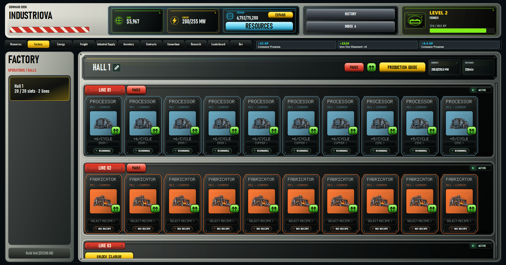

**Energy supply**

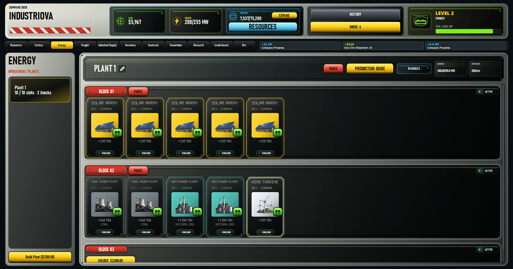

**Freight routing and shipment progress**

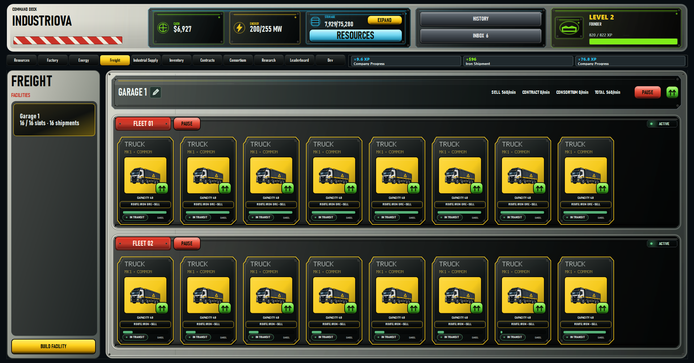

**Research prerequisites**

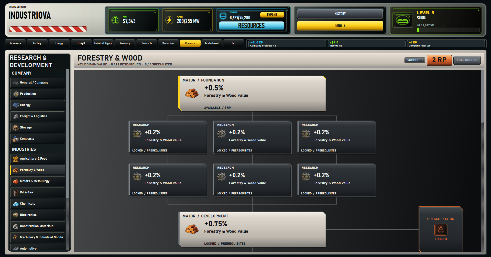

**Industrial Supply**

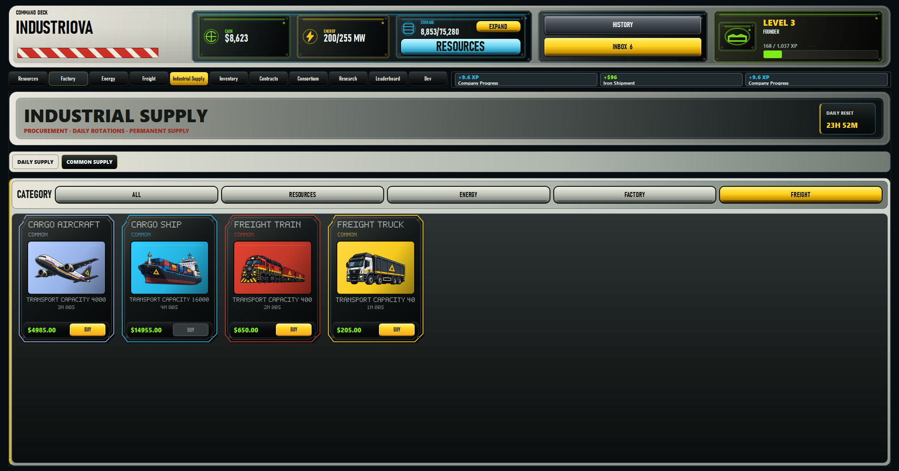

**Production unlock dependencies**

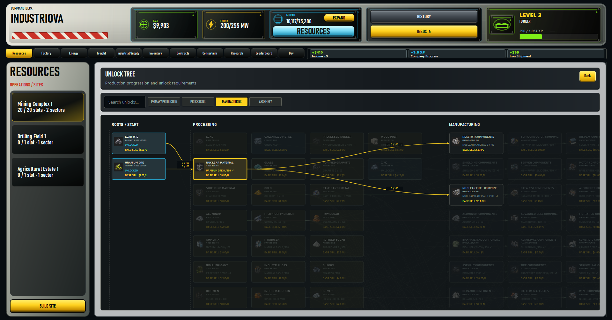

**Chain inspection**

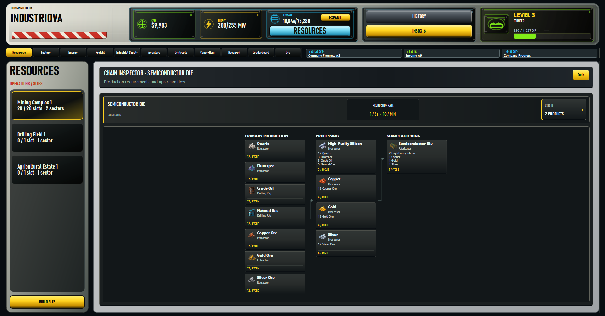

</details>

## Implemented capabilities

- Separate Resources, Factory and Energy boards with compatible machine placement, configuration, pause controls and infrastructure expansion.
- Inventory-based card ownership, Industrial Supply purchases, installation, upgrades and production templates.
- Shared storage, recipe input consumption, energy capacity and fuel constraints.
- Trucks, trains, aircraft and ships with explicit routes, cargo reservations, transit and settlement.
- Regular, Daily and Weekly contracts, priority allocation and optional automatic renewal of Regular contracts.
- Production-based product unlocks, company progression, research prerequisites, modifiers and product specialization.
- Local SQLite saves, history, inbox/activity feedback and optional performance diagnostics.
- Local Consortium and leaderboard functionality. Service interfaces exist; a deployed multiplayer backend is not demonstrated.

Retained legacy modules and compatibility tests are not a list of active navigation features. Packs, recycling and the former Market screen must not be inferred to be current tabs merely because their code remains present.

## Economy and production chains

The data-driven catalog describes primary resources, intermediate processing, components and assembled products. Runtime definitions split extraction, drilling and agriculture into primary machine families. Recipes, base prices and progression data live in [the data package](src/production_zero/data); loading applies additional runtime normalization in [definitions.py](src/production_zero/data/definitions.py) and [release_balance.py](src/production_zero/core/release_balance.py).

Production consumes ingredients and creates output subject to power and available shared storage. MK upgrades, rarity and research affect applicable quantities or modifiers. The Production Guide exposes recipe dependencies. A configured chain can still be blocked by inputs, power or storage, as the Factory screenshot illustrates.

Goods leave stock at freight dispatch and settle after transit. Market settlement uses a dispatch price snapshot. Contract routing accounts for outstanding deliveries, allocates by priority (2, then 1, then Even) and shares a priority group's cargo subject to each contract's remaining need. Regular renewal obtains a new quote rather than reusing a completed order's reward.

The current test ruleset starts primary resources unlocked. Downstream products require 100 self-produced units of each direct ingredient. Settled market sales award 0.1 company XP per dollar of actual revenue; elapsed time alone does not award XP. These rules describe current source and may differ from historical audits. See [progression](src/production_zero/core/progression.py), [XP](src/production_zero/core/company_xp.py), [allocation](src/production_zero/core/contract_allocation.py) and [tests](tests).

## Architecture and technologies

| Layer | Responsibility | Location |
| --- | --- | --- |
| Desktop UI | Qt widgets, boards, interaction and rendering | `src/production_zero/ui/` |
| Domain | State, commands, simulation, economy and progression | `src/production_zero/core/` |
| Catalog | JSON definitions and runtime loading | `src/production_zero/data/` |
| Persistence | SQLite serialization, snapshots and queued writes | `src/production_zero/persistence/` |
| Service boundary | Protocols and local implementations | `src/production_zero/services/` |
| Diagnostics and QA | Instrumentation, fixtures, captures and audits | `src/production_zero/diagnostics/`, `tests/`, `scripts/` |

The application uses Python, PySide6/Qt Widgets, SQLite and JSON. Automated tests use pytest and Qt test facilities. Windows packaging uses PyInstaller. Some historical asset-processing and visual audit tools additionally use Pillow, NumPy or OpenCV; these are not game runtime dependencies.

Important state transitions have command objects. `GameState` separates owned instances from catalog definitions. The simulation updates production and freight; persistence encodes snapshots and orders background writes. This is a layered desktop application, without a claim of complete event sourcing or a hosted service.

## Install and run from source

Windows is the locally validated platform. The project declares Python **3.11+** and pins **PySide6 6.11.1**; this portfolio verification used Python 3.12.14. Other operating systems have not been validated in this review.

```powershell
git clone https://github.com/oezay-kocak/industriova.git
cd industriova
python -m venv .venv
.\.venv\Scripts\python.exe -m pip install -e ".[dev]"
.\.venv\Scripts\python.exe -m production_zero.app
```

The portfolio application source is published in the existing [Industriova repository](https://github.com/oezay-kocak/industriova) on `main`. The repository name has changed; the internal Python package remains `production_zero`.

No external account or API key is needed for local play. Normal saves use `%LOCALAPPDATA%\Industriova\playtests\contract-auto-test\saves`, with fallbacks defined in [paths.py](src/production_zero/persistence/paths.py). Previous test rulesets are not automatically loaded. Start a new company for this ruleset. Source launches enable development controls by default; set `$env:PRODUCTION_ZERO_DEV_MODE='0'` to hide them.

The package `production_zero`, command `pz-economy-stress` and `PRODUCTION_ZERO_*` environment variables remain compatibility identifiers. The displayed brand is Industriova.

## Testing and quality assurance

```powershell
# Standard pytest run
$env:QT_QPA_PLATFORM='offscreen'
.\.venv\Scripts\python.exe -m pytest

# Reviewed full-suite method: fresh process per module, bounded timeouts
.\.venv\Scripts\python.exe scripts/run_release_tests.py . artifacts/portfolio-finalization/tests --timeout 180 --workers 3
```

Inspect every module's exit code in the runner's `results.json`; its own process exit code is not a pass/fail verdict. Process isolation matters for this Qt-heavy suite. Tests cover rules, shipment accounting, progression, migration, save/load, validation and UI interactions. [Current validation](docs/PORTFOLIO_RELEASE_REPORT.md) distinguishes fresh results from historical evidence, native acceptance and longer human playtests.

Final portfolio verification on 25 October 2026: **3,784 tests passed across all 121 modules, with no failures, errors or skips**. Two implementation defects were repaired and 13 obsolete test/fixture expectations aligned with documented current rules; the [case-by-case QA record](docs/QA_FINALIZATION.md) explains the evidence and retained assertions.

Historical Windows build recipes retain dated output names and are not a promise of a current downloadable release. This preparation does not distribute an executable. Older reports can refer to ignored local evidence; see the [documentation guide](docs/README.md).

## Generative AI and personal responsibility

Generative AI has been used in implementation, test and documentation work; asset reports identify supplied AI image batches. Generated work requires review against domain rules and observable behavior. AI-generated code and automated results do not establish authorship of the product concept or human acceptance.

The project initiator designed the game concept, architecture, gameplay loop and every feature, planned the work and directed one or more AI agents through implementation. The initiator did not personally write the code; implementation was carried out by AI agents. This division of responsibility was confirmed by the initiator for this portfolio. The [case study](docs/CASE_STUDY.md#human-direction-and-ai-assisted-work) connects that role to inspectable engineering evidence.

## Roadmap — proposed next work

- Complete native Windows acceptance, including drag-and-drop, DPI behavior and extended sessions.
- Evaluate long-run progression using documented human feedback alongside simulations.
- Consolidate version metadata and superseded build/QA scripts into a versioned release process.
- Decide whether local service interfaces should become network services; deployment is not implemented evidence.
- Keep asset provenance and third-party notices current, and obtain owner approval before publication.

These are proposed steps, not delivered features or dated commitments.

## License and assets

The owner has chosen to retain the original source and documentation **without a general open-source license**. No MIT license is granted. Artwork was created with GPT without external templates, as confirmed by the owner; its reviewed provenance and hashes are recorded separately. Third-party components retain their own terms. See [RIGHTS.md](RIGHTS.md), [the rights review](docs/RIGHTS_REVIEW.md) and [the asset inventory](docs/ASSET_INVENTORY.csv). Public portfolio availability does not imply unrestricted reuse.
