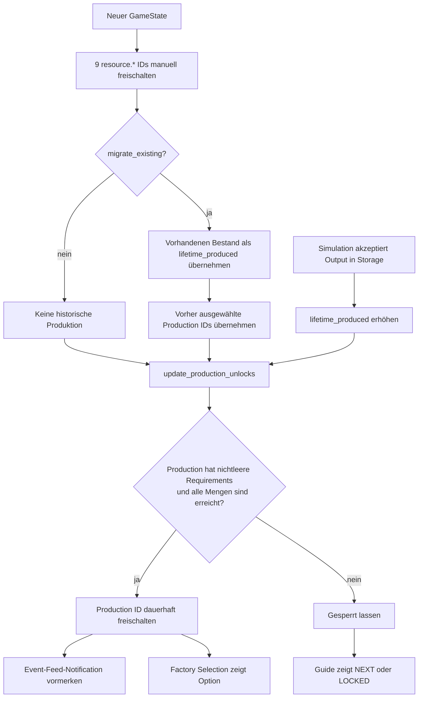

# Resource Progression Unlock Audit

**Repository-Stand:** 7. September 2026\
**Git-Basis:** `main` / `0e4a9e0` plus aktueller, nicht commiteter Arbeitsstand\
**Scope:** Analyse des Resource-/Production-Unlock-Systems. Keine Code-, Daten-, Test-, Save- oder UI-Änderung.

## Ergebnis

Production Zero enthält einen vollständig definierten, streng vierstufigen Produktionsgraphen mit **353 eindeutigen Resources und 353 eindeutigen Production Options**:

| Stage | Machine-Familie | Definitionen | Aus leerem Core-State initial | Im tatsächlichen App-Start initial | Langfristig erreichbar | Unerreichbar |
|---:|---|---:|---:|---:|---:|---:|
| 1 | Extractor | 49 | 9 | 9 | 9 | 40 |
| 2 | Processor | 68 | 0 | 3 | 8 | 60 |
| 3 | Fabricator | 86 | 0 | 0 | 7 | 79 |
| 4 | Assembler | 150 | 0 | 0 | 0 | 150 |
| **Gesamt** |  | **353** | **9** | **12** | **24** | **329** |

Die 329 Inhalte sind in den Daten nicht unvollständig: Sie besitzen jeweils eine Resource-Definition, einen Marktwert und genau eine Production Option. Sie sind über die normale Benutzeroberfläche trotzdem nicht erreichbar. Der unmittelbare Einstiegspunkt des Problems sind **40 inputlose Extractor-Optionen**, die nicht zur manuell gepflegten Startmenge gehören und für die kein späterer Unlock-Pfad existiert. Da jede spätere Stage ausschließlich Outputs der vorherigen Stage konsumiert, blockieren diese 40 fehlenden Wurzeln weitere **60 Processor-, 79 Fabricator- und 150 Assembler-Outputs**.

Das ist ein **systemischer Reachability-Bug innerhalb einer unvollständig implementierten Progressionsumstellung**. Die einzelne Bedingung in `update_production_unlocks()` verhält sich konsistent mit den vorhandenen Tests: spätere Extractor-Ressourcen sollen gerade nicht alle sofort freigeschaltet werden. Es fehlt stattdessen das System, das diese inputlosen Wurzelressourcen später freischaltet.

## Aktueller Unlock-Flow



### 1. Definitionen und Identitäten

`src/production_zero/data/game_definitions.json` enthält heute vier Machine-Familien. Ihre Production Options besitzen `id`, `stage`, direkte Inputs, genau einen Output, Outputmenge, Power, Icon- und Accent-Key. Die Datei enthält **keine** Felder für Level, Unlock-Stufe, Prerequisite, Research oder Technology.

`src/production_zero/data/resource_definitions.json` enthält die 353 Resource-IDs mit Namen, Gameplay-Kategorie, Kapazität, Marktpreis, Volatilität und Icon-/Accent-Key. Auch hier existieren **keine** Progressionsmetadaten.

`src/production_zero/data/definitions.py:45-56` lädt Resource-Metadaten. `src/production_zero/data/definitions.py:59-103` baut die Machine- und Production-Objekte. Die Python-Dataclasses in `src/production_zero/core/definitions.py:10-91` kennen ebenfalls kein Unlock-Level und keine Prerequisite außerhalb der direkten Rezeptinputs.

### 2. Startfreischaltungen

`src/production_zero/core/progression.py:26-38` definiert exakt neun Startressourcen:

1. `iron_ore`
2. `copper_ore`
3. `coal`
4. `bauxite`
5. `limestone`
6. `quartz`
7. `timber`
8. `wheat`
9. `crude_oil`

`initial_production_ids()` wandelt diese IDs in `resource.<resource_id>` um (`progression.py:69-70`). `initialize_production_progress()` vereinigt sie mit dem gespeicherten Unlock-Set (`progression.py:73-82`). In einem leeren Core-Testzustand sind deshalb exakt neun Extractor-Optionen und keine Processor-, Fabricator- oder Assembler-Option verfügbar.

Der tatsächlich von `MainWindow` erstellte App-Startzustand ist leicht anders. `src/production_zero/ui/main_window.py:178-206` legt bereits 145 Iron Ore, 70 Coal und 88 Copper Ore in den Bestand und ruft die Initialisierung mit `migrate_existing=True` auf. `_migrate_existing_production_progress()` behandelt diesen Startbestand als historische Produktion (`progression.py:85-94`). Dadurch werden beim realen App-Start zusätzlich sofort freigeschaltet:

- `recipe.processor.iron`
- `recipe.processor.copper`
- `recipe.processor.steel`

Der reale App-Start besitzt daher **12 auswählbare Production Options**, obwohl der isolierte Progressionstest nur die neun kanonischen Start-IDs erwartet. Weil Migration `emit_pending=False` verwendet, erscheinen diese drei Sofort-Unlocks nicht als neue Unlock-Events. Diese Abweichung verursacht nicht die 329 blockierten Inhalte, zeigt aber, dass Demo-Startbestand und Migrationslogik derzeit vermischt sind.

### 3. Spätere Unlock-Bedingungen

Production Zero verwendet aktuell **Lifetime Production Mastery**:

- Die Simulation zählt nur tatsächlich vom Storage akzeptierten Output (`src/production_zero/core/simulation.py:158-176`). Ein wegen voller Lagerung verworfener Anteil zählt nicht.
- `record_lifetime_production()` addiert diese Mengen dauerhaft und startet danach eine globale Unlock-Prüfung (`progression.py:97-108`). Verbrauch oder Verkauf nimmt den Lifetime-Wert nicht zurück.
- Acht frühe/spezielle Rezepte besitzen explizite Schwellen (`progression.py:46-66`): Iron, Copper, Steel, Iron Components, Copper Wire, Steel Components, Electrical Components und Industrial Equipment.
- Alle übrigen Rezepte leiten für **jeden direkten Input** eine Schwelle ab (`progression.py:165-175`):
  - Processor: `max(60, input_amount × 6)`
  - Fabricator: `max(36, input_amount × 6)`
  - Assembler: `max(12, input_amount × 6)`
- Ein Rezept wird freigeschaltet, sobald alle erforderlichen Lifetime-Mengen erfüllt sind (`progression.py:111-127` und `210-214`). Level, XP, Kartenrarität, Machine-Besitz, Hall-Ausbau und Research werden dabei nicht geprüft.

Die Machine-Familie begrenzt anschließend nur die Kompatibilität. Extractor kann Extractor-Optionen wählen, Processor nur Processor-Optionen usw. Der Besitz einer Machine Card eröffnet die Stage als ausführbare Maschine, schaltet aber keine einzelnen Produkte frei.

### 4. Anzeige und Auswahl

Der Production Guide indexiert **alle 353 Optionen**, unabhängig vom Unlock-Status (`src/production_zero/ui/factory_view.py:1557-1567`). Er sortiert sie als `unlocked`, `next` und `later` (`factory_view.py:1572-1594`).

`production_progress_state()` definiert:

- **unlocked:** Production ID liegt im gespeicherten Unlock-Set.
- **next:** Die Option besitzt Requirements und alle dafür genannten Inputs sind als Outputs bereits freigeschaltet oder historisch produziert.
- **later:** Alles andere.

Die sichtbaren Texte entstehen in `factory_view.py:530-572`: `UNLOCKED`, `NEXT - <Fortschritt>` oder `LOCKED - Later production step`. Für einen gesperrten inputlosen Extractor liefert `unlock_requirements_for()` ein leeres Tupel. Er kann dadurch niemals `next` werden und bleibt dauerhaft `later`, ohne eine konkrete Anforderung anzuzeigen.

Die Factory Resource/Recipe Selection filtert mit `production_options_for_machine()` ausschließlich freigeschaltete Optionen (`factory_view.py:1840-1863`). `_apply_production_option()` prüft den Unlock ein zweites Mal (`factory_view.py:2190-2202`). `FactoryViewV2` blendet den Wechsel-Trigger zudem aus, wenn weniger als zwei freigeschaltete Optionen existieren (`src/production_zero/ui/factory_view_v2.py:745-752`).

Der Core-Command `SelectMachineProduction` selbst validiert den Unlock-Status nicht (`src/production_zero/core/commands.py:325-344`). Auch die Simulation prüft bei einer bereits gesetzten Auswahl nur Machine-Kompatibilität, Inputs, Storage und Power. Ein Save oder interner Toolpfad kann daher eine gesperrte Production ID weiterhin ausführen. „Unerreichbar“ bedeutet hier: **aus einem sauberen Spielstand über den normalen UI- und Progressionspfad unerreichbar**, nicht durch eine harte Simulationsinvariante unmöglich.

### 5. Nebenwirkungen in anderen Systemen

- `eligible_contract_products()` überspringt gesperrte Production Options (`src/production_zero/core/production_values.py:155-182`). Die 329 Inhalte fehlen damit auch als regulär auswählbare Contract-Produkte.
- Die Contract-Kapazität verwendet die Anzahl freigeschalteter Produktionen als einen Fallback-Faktor (`src/production_zero/core/contracts.py:360-375`). Das festgefahrene Unlock-Set beeinflusst somit auch die Skalierung unkonfigurierter Contract-Situationen.
- Der Event Feed verbraucht `pending_unlock_ids` und zeigt `<Produkt> unlocked` (`src/production_zero/ui/event_feed.py:245-254`). Für die 40 blockierten Wurzeln kann nie ein solches Event entstehen.
- Factory-Line- und Slot-Unlocks sind separate, cash-basierte Ausbaupfade. Sie ändern das Production-Unlock-Set nicht.

## Root Cause

### Direkter Codepfad

Alle 49 Extractor-Optionen sind inputlos. Für jede inputlose Option gilt in `unlock_requirements_for()`:

```python
if not option.input_resources:
    return ()
```

`update_production_unlocks()` schaltet jedoch nur bei einem **nichtleeren** Requirement-Tupel frei:

```python
requirements = unlock_requirements_for(option)
if requirements and _requirements_met(state, requirements):
    ...
```

Neun Extractor-IDs gelangen über `INITIAL_PRODUCTION_RESOURCE_IDS` am Prüfer vorbei. Die übrigen 40 erhalten weder Requirements noch einen alternativen Level-, Discovery-, Research-, Contract- oder Card-Unlock. Sie bleiben permanent gesperrt.

### Warum daraus 329 blockierte Ressourcen werden

Die aktive Datenstruktur ist ein sauberer Stage-DAG:

- alle 68 Processor-Rezepte konsumieren ausschließlich Extractor-Outputs;
- alle 86 Fabricator-Rezepte konsumieren ausschließlich Processor-Outputs;
- alle 150 Assembler-Rezepte konsumieren ausschließlich Fabricator-Outputs;
- jeder Extractor-, Processor- und Fabricator-Output führt strukturell zu mindestens einem Assembler-Produkt.

Diese Invarianten sind in `tests/test_card_definitions.py:177-216` und `281-316` explizit geprüft. Eine rekursive Reachability-Prüfung ab den neun Startwurzeln endet bei 24 Outputs: 9 Extractor, 8 Processor, 7 Fabricator, 0 Assembler. Selbst beliebig hohe Lifetime-Mengen der erreichbaren Ressourcen öffnen keinen weiteren Pfad, weil die nächste benötigte Wurzel nicht produziert werden kann.

### Bug, unvollständige Implementierung oder absichtliche Sperre?

Die korrekte Einordnung lautet:

1. **Die anfängliche Begrenzung ist absichtlich.** `tests/test_production_progression.py:35-50` verlangt ausdrücklich mehrere frühe Zweige, keine Processor-Optionen im leeren Core-State und gesperrte Einträge wie Natural Gas und Tin Ore.
2. **Die permanente Unerreichbarkeit ist ein Bug.** Es gibt keinen Test und keine Dokumentation, die 329 dauerhaft tote Inhalte als gewünschtes Verhalten ausweist. Die Inhalte werden weiterhin geladen, indiziert, bewertet und im Guide angezeigt.
3. **Die Ursache ist eine unvollständige Progressionsarchitektur.** Die Startauswahl und das downstream gerichtete Lifetime-System wurden implementiert; ein Mechanismus für weitere inputlose Wurzeln fehlt.
4. **Das `requirements and` ist nicht isoliert zu „reparieren“.** Würde man nur diese Bedingung entfernen und das leere Tupel als erfüllt behandeln, wären alle 49 Extractor-Ressourcen sofort verfügbar. Das widerspräche dem getesteten Ziel, das Early Game nicht mit dem kompletten Extractor-Katalog zu überladen.

## Level, XP und ungenutzte Platzhalter

Company XP entsteht derzeit durch abgeschlossene Contracts (`src/production_zero/core/contracts.py:497-510`). Das Levelsystem in `src/production_zero/core/company.py:44-98` berechnet XP-Schwellen und Titel. Titelmilestones bei Level 10, 25, 50, 75 und 100 gewähren zusätzlich Packs (`contracts.py:524-530`).

`LevelUpRewardDefinition` besitzt seit der commiteten Basis ein Feld `unlock_ids` (`company.py:16-22`). `level_up_reward_for_level()` erzeugt jedoch ausschließlich leere Reward-Objekte; nirgends wird `unlock_ids` befüllt oder auf `production_progress.unlocked_production_ids` angewendet. Das Feld wird lediglich gespeichert und geladen (`src/production_zero/persistence/sqlite_store.py:345-353`). Es ist ein **toter/ungenutzter generischer Platzhalter**, aber kein teilweise gepflegter Resource-Levelplan.

Die JSON-Definitionen enthalten null Vorkommen von Unlock-, Level-, Tier-, Prerequisite-, Research- oder Technology-Feldern. Im ausführbaren Code existiert kein Research- oder Technology-System. `docs/recipe-card-retirement.md:9` beschreibt nur eine spätere Richtung: Recipes sollen künftig als permanentes Wissen in einem Technology- oder Talent-Tree erscheinen; der damalige Pass implementierte ausdrücklich keinen solchen Mechanismus.

## Save-/Load-Verhalten

Der aktuelle Save speichert drei Progressionsbestandteile (`src/production_zero/persistence/sqlite_store.py:134-138`):

- `lifetime_produced`
- `unlocked_production_ids`
- `pending_unlock_ids`

Beim Laden eines aktuellen Saves bleiben alle gespeicherten IDs erhalten und die neun Start-IDs werden ergänzt (`sqlite_store.py:437-453`). Es findet beim Deserialisieren keine Validierung gegen aktuelle Definitionen und keine vollständige Neuberechnung der Unlocks statt.

Bei einem Legacy-Save ohne `production_progress` werden vorhandene Lagerbestände als Lifetime Production interpretiert und bereits ausgewählte Production IDs übernommen (`sqlite_store.py:454-464`). Eine alte Auswahl kann dadurch auch dann erhalten bleiben, wenn sie im neuen System regulär gesperrt wäre. Beim nächsten Simulationstick prüft `record_lifetime_production()` die aus den Beständen abgeleiteten Schwellen erneut; auch ein leerer Output-Datensatz startet diese Prüfung.

`tests/test_production_progression.py:119-145` und `tests/test_sqlite_store.py:100-212` sichern Persistenz, Start-ID-Union und die konservative Legacy-Übernahme ab. Kein Test prüft, dass alle 353 Optionen irgendwann erreichbar sind.

## Rekonstruktion der Designabsicht

### Sicher aus Code und Historie belegbar

- Der letzte Commit `0e4a9e0` enthielt bereits alle 353 Machine-Production-Options: 49 Extractor, 68 Processor, 86 Fabricator und 150 Assembler.
- Derselbe Commit enthielt zusätzlich **304 Recipe Card Definitions**, exakt für die 68 + 86 + 150 downstream Produktionen. Extractor-Ziele waren keine Recipe Cards.
- Im commiteten Factory-Pfad wurden Machine-Optionen ohne Progressionsfilter angeboten. Alle 49 Extractor-Ziele und alle Machine-kompatiblen downstream Optionen waren grundsätzlich auswählbar.
- Recipe Cards waren in Supply und Packs sammelbar, aber nicht als Factory-Maschinen platzierbar. Die Production Selection prüfte ihren Besitz nicht. Sie waren daher kein belastbares Unlock-System für die Machine-Optionen.
- Im aktuellen Arbeitsstand sind Recipe Cards aus Inventory, Supply, Packs und Crafting entfernt. Ihre stabilen `recipe.*`-IDs leben als permanente Production Options weiter. Legacy-Recipe-Cards werden beim Laden verworfen.
- Das aktuelle Lifetime-System soll den späteren Katalog schrittweise öffnen und den Guide mit konkreten Produktionszielen versorgen.
- Der vollständige Produktionsgraph wurde als vierstufige, anschließbare Kette gebaut. Die Inhaltsdaten selbst sprechen klar gegen dauerhaft tote Zweige.

### Wahrscheinlich aus Struktur und Begleitdokumenten ableitbar

- Die Recipe-Card-Retirement-Phase sollte die doppelte Identität „sammelbare Karte plus auswählbare Machine-Option“ durch permanentes Produktionswissen ersetzen.
- Die neun Startwurzeln wurden als kuratierter Early-Game-Satz gewählt. Lifetime-Schwellen sollten das Beherrschen eines Inputs belohnen und die jeweils nächste Verarbeitung sichtbar machen.
- `next` und `later` im Guide sind für einen fortschreitenden Katalog gedacht. Ein `later`-Status ohne jemals erfüllbare Bedingung ist sehr wahrscheinlich eine Lücke, kein finales Design.
- Der generische `unlock_ids`-Slot bei Level-Rewards zeigt, dass Level-basierte Inhaltsfreischaltungen architektonisch einmal mitgedacht wurden. Es gibt jedoch keine Belegung, die eine konkrete frühere Resource-Levelplanung beweist.

### Nicht belegbar

- Welche der 40 späteren Extractor-Wurzeln auf welchem Level, nach welchem Contract oder in welcher Reihenfolge erscheinen sollten.
- Ob für diese Wurzeln ursprünglich Company Level, eine reine Chain-Discovery oder das zukünftige Research-System vorgesehen war.
- Ob die aktuellen acht expliziten Schwellen finale Balancewerte oder nur Early-Game-Beispiele sind.
- Eine historische, funktionsfähige Level-/Tier-Unlock-Tabelle wurde nicht gefunden. Es wurde daher kein solches System entfernt; der letzte commitete Stand hatte stattdessen weitgehend freie Machine-Auswahl.

## Drei Lösungsvarianten

Die Varianten beschreiben Zielmodelle. Keine davon ist in diesem Audit implementiert.

### A. Level-basierte Unlocks

**Regel**

Jede Production Option erhält ein verbindliches `unlock_level`. Die neun heutigen Startwurzeln bleiben Level 1. Die übrigen Extractor-Ressourcen werden in kleine thematische Levelbänder verteilt. Downstream Optionen erhalten mindestens das höchste Level ihrer direkten Inputs und zusätzliche Stage-Abstände. Eine Option ist auswählbar, sobald `company.level >= unlock_level`; Lifetime Production beeinflusst ihre Freischaltung nicht. Spätestens auf einem festgelegten Baseline-Maximum, beispielsweise Level 75 oder 100, sind alle 353 Optionen erreichbar.

**Vorteile**

- Sehr leicht erklärbar: „Erreiche Level N“.
- Nutzt das bereits vorhandene Company-XP-System und seine unbegrenzte Levelentwicklung.
- Early Game lässt sich über kleine Levelbänder zuverlässig dosieren.
- Guide kann jede Sperre mit einer einzigen eindeutigen Zahl anzeigen.

**Nachteile**

- Spieler können komplexe Produkte freischalten, ohne ihre Vorstufen praktisch betrieben zu haben.
- Fortschritt hängt stark an Contracts, weil sie derzeit die XP-Quelle sind.
- 353 Levelzuordnungen benötigen Contentpflege; falsche Level können Produktionsketten in unlogischer Reihenfolge öffnen.
- Das bestehende Lifetime-System würde für Unlocks weitgehend bedeutungslos.

**Bestehende Saves**

Beim Laden werden alle Optionen bis zum gespeicherten Company Level freigeschaltet. Bereits gespeicherte oder ausgewählte Unlocks bleiben als Besitzstand erhalten; nichts wird relocked. Ohne Unterdrückung könnte die Migration viele Notifications erzeugen, daher sollte sie still erfolgen.

**Guide und Factory Selection**

Guide: `UNLOCKED` oder `LEVEL N`. Factory Selection zeigt nur Level-erfüllte Optionen. Die `next`-Logik wird durch „nächste Level-Freischaltungen“ ersetzt.

**Aufwand / Risiko:** mittel / mittel. Die Mechanik ist klein, die sorgfältige Levelbelegung groß.

### B. Rein chain-basierte Unlocks

**Regel**

Die neun Startwurzeln bleiben bestehen. Jede der übrigen 40 inputlosen Extractor-Optionen erhält eine explizite, azyklische Discovery-Anforderung aus bereits früher erreichbaren Produkten. Die Wurzeln werden in kleine Gruppen von etwa vier bis sechs Resources gestaffelt; eine Gruppe öffnet nach definierten Lifetime-Mengen aus der vorherigen Gruppe oder deren verarbeiteten Produkten. Processor, Fabricator und Assembler behalten direkte Input-Mastery als Regel. Eine automatische Validierung muss beweisen, dass jede Option vom Startset aus erreichbar ist.

**Vorteile**

- Fortschritt entsteht direkt aus dem Kerngameplay: produzieren, verarbeiten, neue Branche erschließen.
- Der vorhandene Lifetime-State, Event Feed und die `NEXT`-Anzeige können weiterverwendet werden.
- Produktionsketten werden tatsächlich gespielt, bevor komplexere Inhalte erscheinen.
- Company Level und zukünftiges Research bleiben vollständig unabhängig.

**Nachteile**

- Für inputlose Rohstoffe sind Abhängigkeiten spielmechanisch abstrakt: Warum schaltet produzierte Ware ein neues Erzvorkommen frei?
- Eine 40 Wurzeln umfassende Discovery-Kette ist schwerer zu überblicken und zu balancieren.
- Multi-Input-Schwellen können Grind und ungewollte Sackgassen erzeugen.
- Der Guide muss weit entfernte Wurzel-Prerequisites verständlich erklären.

**Bestehende Saves**

Gespeicherte Unlocks bleiben erhalten. Fehlende Unlocks werden aus `lifetime_produced` nachgezogen. Legacy-Saves kennen nur aktuellen Bestand und ausgewählte Produktionen als Näherung; fortgeschrittene Spieler könnten deshalb zunächst zu wenig freigeschaltet bekommen. Migration sollte niemals bestehende Auswahl sperren und keine Event-Flut erzeugen.

**Guide und Factory Selection**

Guide: jede gesperrte Wurzel zeigt konkrete `Produce X <Resource>`-Ziele; downstream bleibt `NEXT` mit direkten Inputs. Factory Selection ändert ihr Grundprinzip nicht.

**Aufwand / Risiko:** hoch / hoch. Die Engine-Erweiterung ist überschaubar, Content-DAG und Balancing sind umfangreich.

### C. Hybrid aus Level-Discovery und Chain-Mastery

**Regel**

Company Level steuert ausschließlich die **Entdeckung neuer inputloser Extractor-Wurzeln**. Die neun heutigen Startressourcen bleiben Level 1; die übrigen 40 werden in kleine, explizit datengetriebene Branchenbänder eingeteilt. Alle Processor-, Fabricator- und Assembler-Optionen bleiben an Lifetime Production ihrer direkten Inputs gebunden. Optional erhält eine downstream Option zusätzlich das abgeleitete Mindestlevel `max(unlock_level aller Root-Ancestors)`, damit sie nie vor ihrer Rohstofffamilie angekündigt wird. Research wird nicht benötigt, um eine der 353 Baseline-Ressourcen zu erreichen.

Eine mögliche verständliche Bandstruktur wäre:

- Level 1: heutige neun Startressourcen;
- frühe Level: zusätzliche Landwirtschaft, Basisminerale und Natural Gas;
- mittlere Level: gängige Industrie- und Legierungsmetalle;
- höhere Level: Elektronik-, Chemie-, Edelmetall-, Nuklear- und Rare-Earth-Wurzeln.

Alle Root-Bänder müssen vor einem festgelegten Baseline-Level geöffnet sein. Ab dann macht der Spieler die verbleibenden downstream Produkte ausschließlich durch Nutzung ihrer Ketten verfügbar.

**Vorteile**

- Level liefert klare, seltene Katalogerweiterungen; Chain-Mastery liefert häufige, motivierende Produkt-Unlocks.
- Das Early Game bleibt klein, ohne künstliche Rohstoff-zu-Rohstoff-Abhängigkeiten.
- Der bestehende Guide, Lifetime-State und Event Feed bleiben sinnvoll.
- Das Modell passt zum Idle-/Tycoon-Loop: Contracts treiben Unternehmensfortschritt, laufende Produktion vertieft einzelne Branchen.
- Zukünftiges Research kann Effizienz, Spezialisierung oder optionale Technologien liefern, ohne die Baseline-Reachability zu übernehmen.

**Nachteile**

- Zwei Bedingungen müssen klar kommuniziert werden.
- Root-Levelbänder und Lifetime-Schwellen müssen gemeinsam balanciert werden.
- Ohne Datenvalidierung können fehlerhafte Root-Level oder Requirements erneut Sackgassen erzeugen.

**Bestehende Saves**

Beim Laden gilt eine monotone Union: gespeicherte Unlocks und bestehende ausgewählte Production IDs bleiben erhalten; Root-Optionen bis zum gespeicherten Company Level werden ergänzt; erfüllte Chain-Schwellen werden nachgezogen. Migration läuft ohne `pending_unlock_ids`. Legacy-Saves verwenden Level plus vorhandenen Bestand/Selections als konservative Basis. Es wird nie relocked.

**Guide und Factory Selection**

Guide unterscheidet drei klare Zustände: `LEVEL N` für noch unentdeckte Roots, `NEXT - Produce ...` für sichtbare Chain-Schritte und `UNLOCKED`. Factory Selection zeigt weiterhin nur freigeschaltete, zur Machine-Familie kompatible Optionen. Eine kleine „Next at Level N“-Zusammenfassung kann die nächste Root-Gruppe ankündigen, ohne gesperrte Endgame-Produkte in die Auswahl zu mischen.

**Aufwand / Risiko:** mittel bis hoch / mittel. Es braucht ein kleines Level-Gate, Datenfelder für 49 Roots, Save-Normalisierung und vollständige Reachability-Tests; der downstream Mechanismus existiert bereits.

## Empfehlung

**Variante C, Hybrid aus Level-Discovery und Chain-Mastery, passt am besten zu Production Zero.**

Die 49 inputlosen Extractor-Optionen benötigen eine externe, leicht lesbare Taktung. Company Level ist dafür bereits vorhanden und thematisch plausibel: Ein wachsendes Unternehmen erschließt neue Rohstoffsektoren. Die 304 downstream Optionen bilden dagegen echte Produktionsketten. Ihre Freischaltung durch Lifetime Production belohnt den Kern des Spiels und lässt den Production Guide konkrete nächste Ziele anzeigen.

Diese Trennung hält das System verständlich:

- **Level öffnet neue Rohstofffamilien.**
- **Produktion öffnet die Verarbeitung dieser Rohstoffe.**
- **Research bleibt ein späteres, separates Meta-System.**

Vor einer Umsetzung sollte zuerst eine datengetriebene Root-Leveltabelle für alle 49 Extractor-Outputs festgelegt werden. Danach müssen automatisierte Invarianten für jeden Build gelten:

1. Jede Production Option besitzt genau einen erklärbaren Unlock-Pfad.
2. Jede downstream Option kann erst nach sämtlichen direkten Inputs erreichbar werden.
3. Alle 353 Outputs sind von Level 1 bis zum festgelegten Baseline-Maximum theoretisch erreichbar.
4. Bestehende Saves verlieren keine Unlocks und keine ausgewählte Production.
5. MainWindow-Startbestand und Legacy-Migration werden getrennt behandelt, damit Starterressourcen nicht unabsichtlich als historische Produktion zählen.

Die aktuelle Blockade sollte daher später nicht mit einem pauschalen „alle inputlosen Optionen freischalten“ behoben werden. Der fehlende Baustein ist eine kontrollierte Root-Discovery; das vorhandene chain-basierte System kann anschließend den Rest des Graphen tragen.

## Prüfgrundlage

Die Analyse wurde gegen folgende aktive und historische Pfade durchgeführt:

- `src/production_zero/core/progression.py`
- `src/production_zero/data/game_definitions.json`
- `src/production_zero/data/resource_definitions.json`
- `src/production_zero/core/company.py`
- `src/production_zero/core/contracts.py`
- `src/production_zero/core/production_values.py`
- `src/production_zero/core/simulation.py`
- `src/production_zero/core/production_guide.py`
- `src/production_zero/ui/factory_view.py`
- `src/production_zero/ui/factory_view_v2.py`
- `src/production_zero/ui/main_window.py`
- `src/production_zero/ui/event_feed.py`
- `src/production_zero/persistence/sqlite_store.py`
- `tests/test_production_progression.py`
- `tests/test_card_definitions.py`
- `tests/test_company.py`
- `tests/test_sqlite_store.py`
- `docs/recipe-card-retirement.md`
- Git-Basis `0e4a9e0` für den früheren Recipe-Card-/freien-Selection-Stand

Es wurde keine reale GUI gestartet. Dieser Audit verändert ausschließlich diese Dokumentationsdatei.
